# StockDashboard · A股桌面行情

原生 macOS 桌面行情浮窗：看持仓、看指数，展开分时与日K，再双击进入可缩放、画线的大图。

**Apple Silicon Mac · macOS 13+ · Swift / SwiftUI · 图示版本 1.15.1**

[功能图册](#功能图册) · [鼠标与快捷键](#鼠标与快捷键) · [构建与安装](#构建与安装) · [详细使用说明](macos/README.md)

- 持仓与八大指数两页看板，顶部全A涨跌和成交额、底部报价时间与总盈亏。
- 每只股票提供「持仓／分时／日K」按钮，统一展开和高亮方式。
- 分时价格与分钟量；日K小图最近60日，大图最多载入1000个实际交易日。
- 大日K支持滚轮/捏合缩放、拖动历史、价格标记、两点连线、水平线。
- 点击已有标注使其变蓝，按 **Esc** 删除选中项；支持撤销与本地保存。
- 每股成本＋股数、上下价格提醒、透明度、置顶、右侧自动吸附、登录自启动。

## 功能图册

以下图片由 **1.15.1 的原生界面组件**生成，点击图片可查看原尺寸。持仓、报价、竞价和异常状态使用独立演示数据；大日K使用公开上证指数历史快照。图片不包含用户真实持仓，也不代表当前实时行情。为便于阅读，截图使用浅色底；实际桌面浮窗可调整背景透明度。

### 1. 持仓看板与综合指数

左图展示股票行情、持仓盈亏和价格提醒；右图是固定的八指数看板。切换指数页时，持仓行情和提醒仍会继续更新。

| 持仓股 | 综合指数 |
| --- | --- |
| 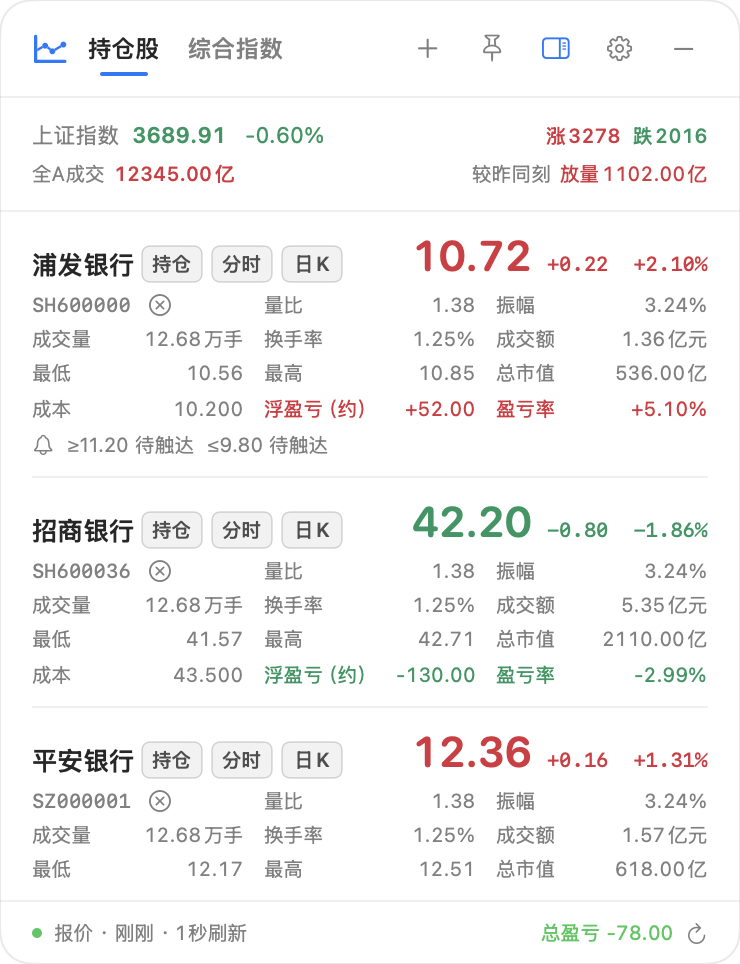 | 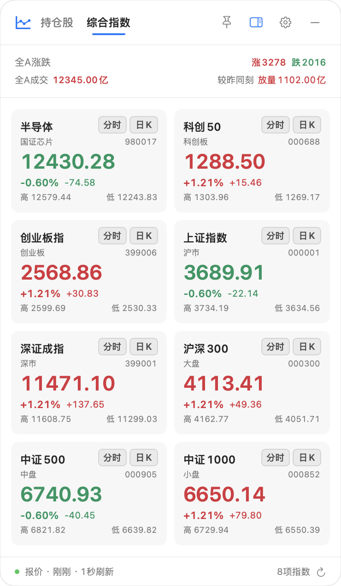 |

股票卡片包含现价、涨跌额/幅、量比、振幅、成交量、换手率、成交额、最低、最高和总市值。填写持仓后增加每股成本、浮盈亏和盈亏率；底部总盈亏只汇总已设置持仓的股票。红涨绿跌，未获得的数据显示「—」。

顶部全A区域显示上涨/下跌家数、累计成交额，以及较上一交易日同刻的放量或缩量金额。

### 2. 添加股票、顶部控件与透明度

点击「＋」打开名称或代码输入框。中文名称会显示候选，点击候选或按回车确认；多匹配时由用户选择。六位代码支持回车追加，也可用逗号分隔多个代码。首次打开没有预设股票。

| 股票名称/代码输入 | 背景透明度调节 |
| --- | --- |
| 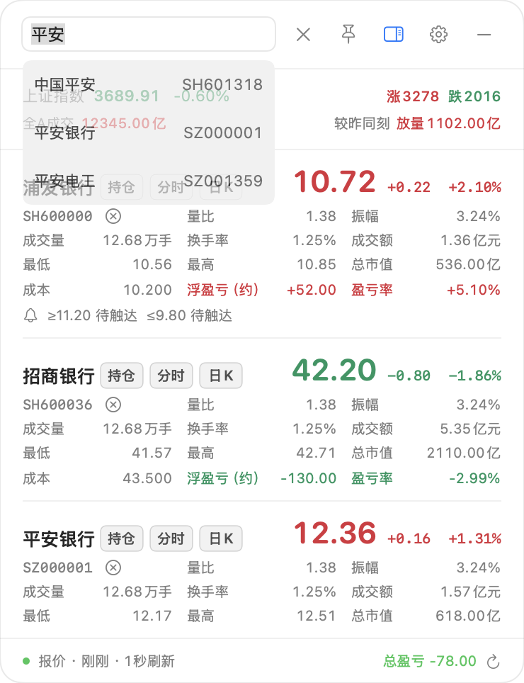 | 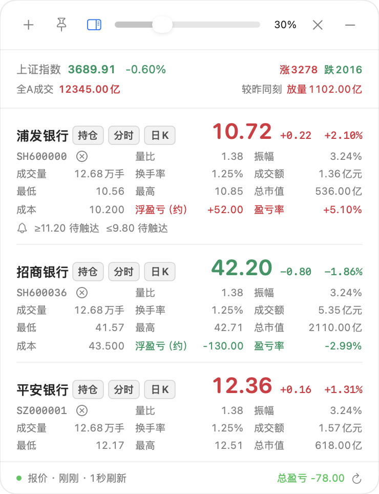 |

| 顶部控件 | 作用 |
| --- | --- |
| 持仓股／综合指数 | 切换列表；切页会收起编辑区和当前图表 |
| ＋ | 添加股票；输入框内 Esc 收起输入 |
| 图钉 | 切换浮窗置顶 |
| 右侧吸附按钮 | 蓝色开启，灰色关闭；与菜单栏开关同步 |
| 齿轮 | 就地展开0%—100%透明度滑条，设置即时保存 |
| 减号 | 隐藏浮窗，可从菜单栏重新显示 |
| 标题左侧图标和空白处 | 拖动窗口；其他按钮与输入控件独立操作 |

### 3. 持仓成本、股数与价格提醒

点击股票名称或「持仓」，在原卡片展开输入。当前只保留 **每股成本＋当前数量**，点击「保存成本」保存；上下提醒价可以单独设置或留空关闭。

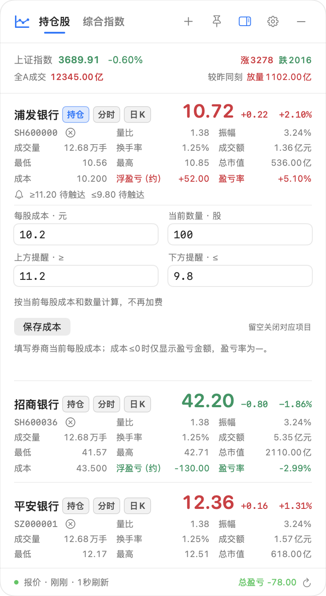

- 每股成本填写券商显示的已含费成本，支持最多8位小数及零/负成本；不重复加费。
- 成本和股数须同时填写或同时留空；零/负成本仍计算盈亏金额，盈亏率显示「—」。
- 只改提醒、不改成本和股数时，保留旧记录的原始总成本精度。
- 每个方向的提醒触达后只提示一次；可点击「重新启用提醒」重新等待触发。
- 系统通知需在菜单栏启用并获得 macOS 授权。程序不连接券商账户。

**已触达提醒的卡片与重新启用入口：**

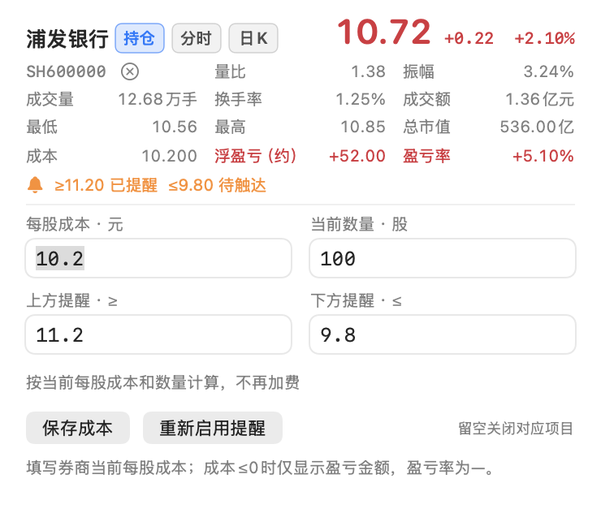

### 4. 分时与日K在同一区域展开

「持仓／分时／日K」放在股票名称旁。分时与日K共享卡片下方的区域，选中的按钮以蓝色高亮。再点同一按钮收起，点另一个按钮直接切换；一次只展开一张图。

| 分时与分钟量 | 最近60日的日K与日成交量 |
| --- | --- |
| 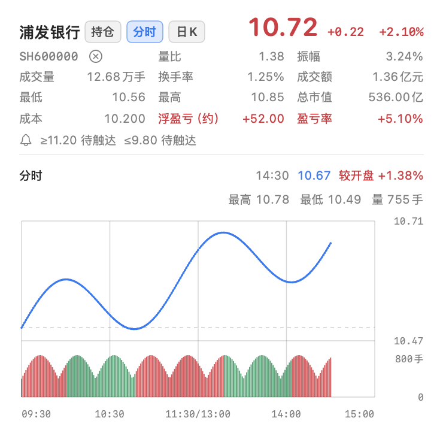 | 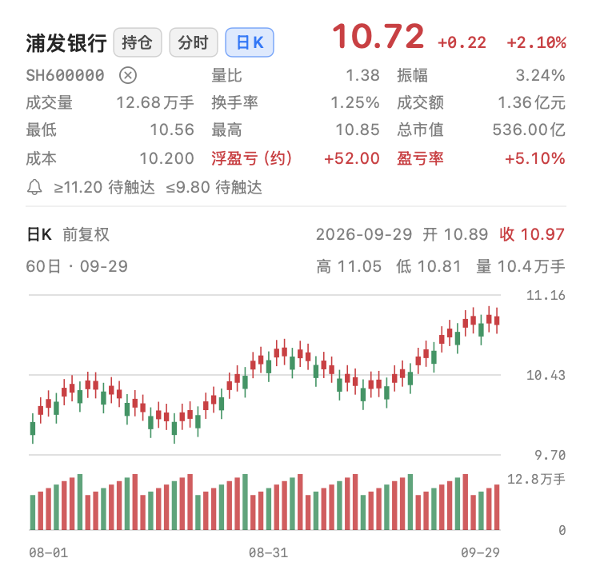 |

综合指数也提供「分时／日K」按钮，图表展开在所在行下方并横跨两列。图表使用加深网格，便于对照价格刻度。

### 5. 双击打开大图，悬停查看行情数值

双击分时或日K绘图区，在当前屏幕中央打开大号悬浮窗口，支持拖动与调整大小。关闭大图保留小图；切换证券或图表类型时大图同步切换，收起小图或切页时大图关闭。

**大分时图：**蓝线表示价格，虚线为昨收，下方为分钟成交量；午休时间在横轴压缩。鼠标悬停查看对应时间、价格、较开盘变化和分钟量，当日最高/最低始终来自行情快照。

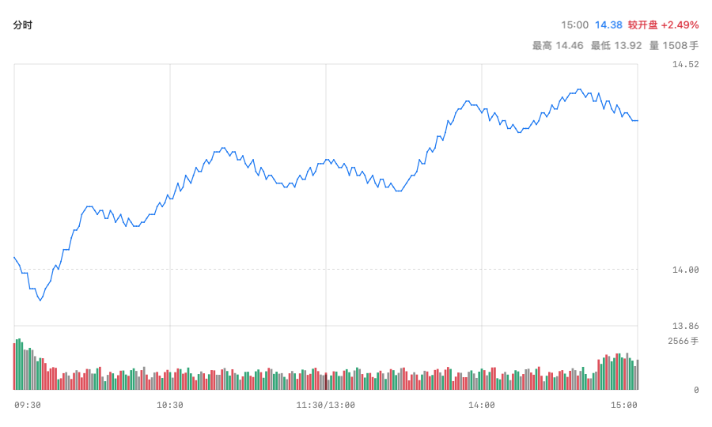

**大日K默认60日：**显示日期、开盘、收盘、最高、最低和日成交量，并注明实际复权口径。悬停会切换到对应交易日数值。

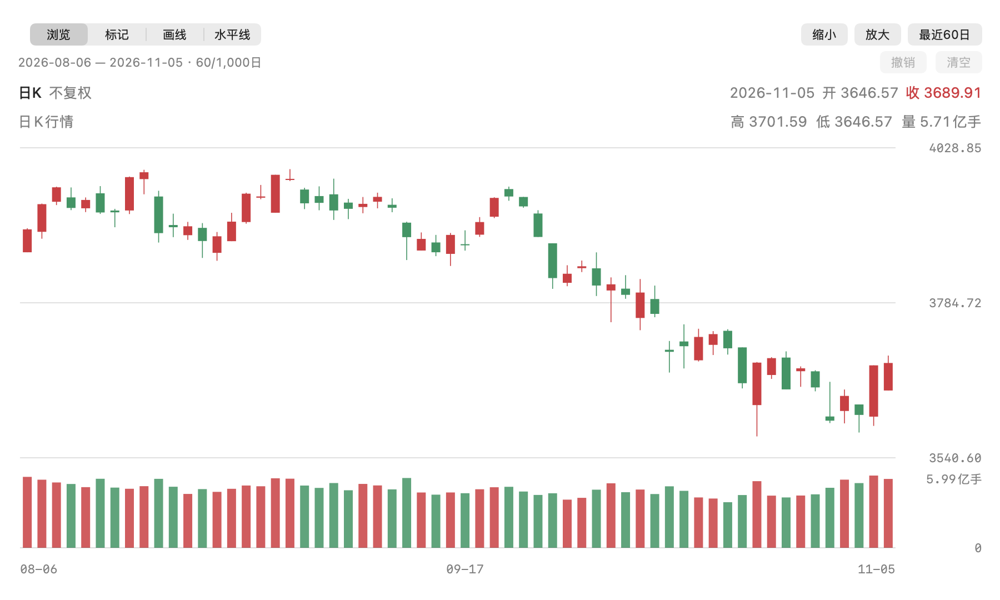

### 6. 滚轮缩放与拖动历史

在大日K绘图区向上滚轮放大、向下滚轮缩小；触控板可捏合。缩放以鼠标所在日期为中心。在「浏览」模式按住鼠标左右拖动查看历史，点击「最近60日」返回最新。

下图已缩小到 **240/1000日** 并拖动到历史区间，左上显示可见起止日期。最少显示10根；上市时间或数据源覆盖不足时，按实际返回数量展示。

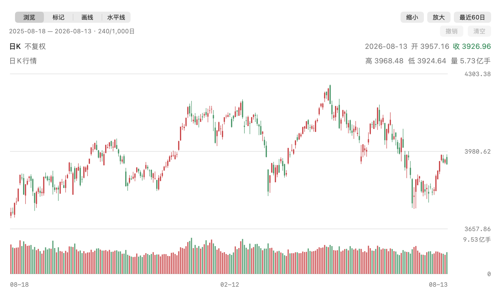

### 7. 打标记、画线、选中后 Esc 删除

工具栏提供三种标注，均按日期和价格定位，缩放或拖动不会改变标注数值。标注按证券和复权口径分别保存在本机，重新打开仍保留。

| 工具 | 操作 |
| --- | --- |
| 标记 | 在价格区单击，放置一个带价格读数的点 |
| 画线 | 依次单击起点和终点，连接两点；第二点确定前显示预览 |
| 水平线 | 单击确定价格，绘制横跨价格区的水平线 |
| 浏览 | 拖动查看历史；点击已有标注可选中 |

**三类标注同时展示：**橙色价格点、两点连线和水平虚线。

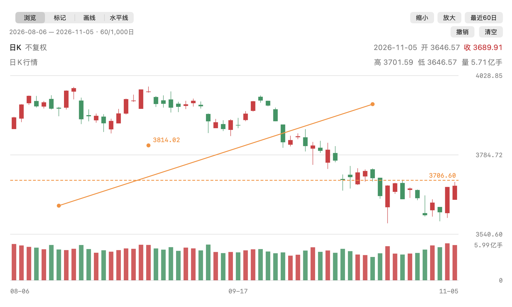

**再次点击已有线条或标记：**选中项变蓝，界面提示「已选中 · Esc删除」。无需先清空所有标注；绘图工具开启且没有未完成草稿时，也可直接点选旧标注。

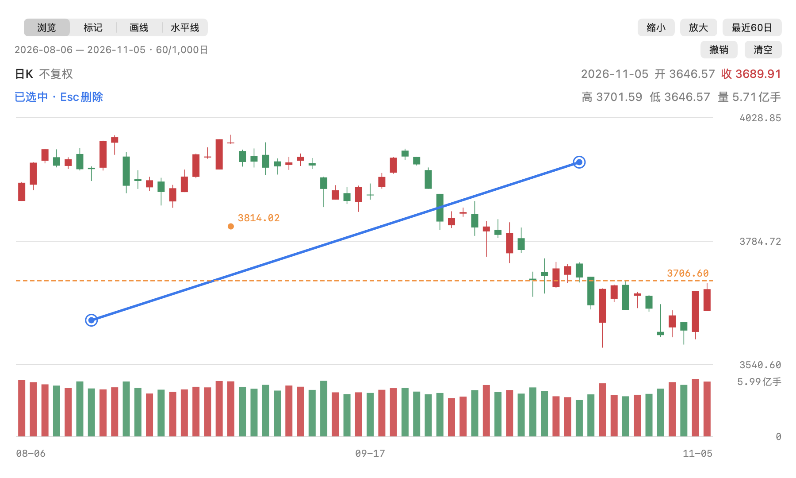

**按 Esc 后：**只删除选中的趋势线，其他价格标记和水平线保留。下图由实际选中、按 Esc 的操作生成。

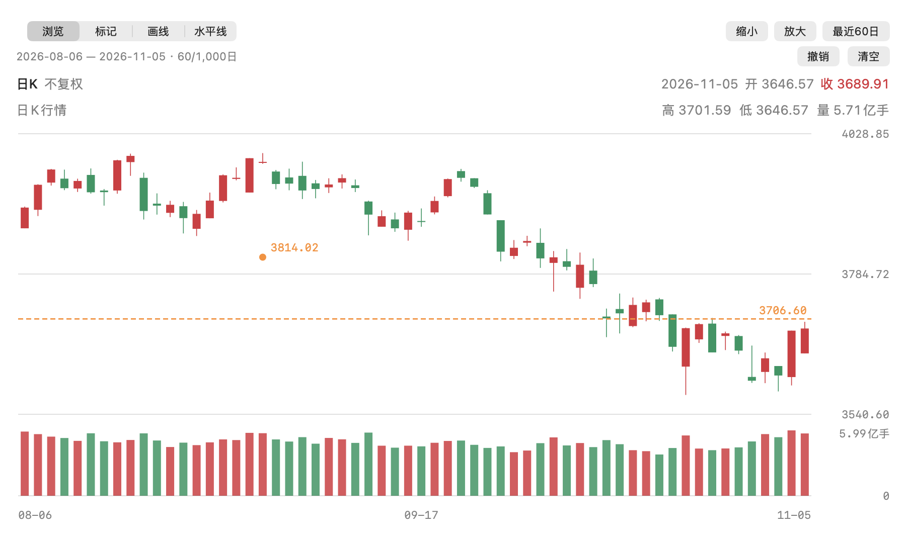

- 正在画线时按 Esc，取消未完成的线并回到浏览。
- 没有选中对象时按 Esc，只退出绘图模式，不删除其他标注。
- 浏览模式点击空白处取消选择；误删可点击「撤销」恢复。
- 「清空」清除当前证券、当前复权口径下的标注，也可撤销。
- 前复权行情以后可能重新计算历史价格；标注保留创建时的价格。

### 8. 小尺寸窗口也能操作

大图最小内容尺寸为560×360。工具选择、缩放、日期范围、撤销和清空分两行显示，仍可完整操作。

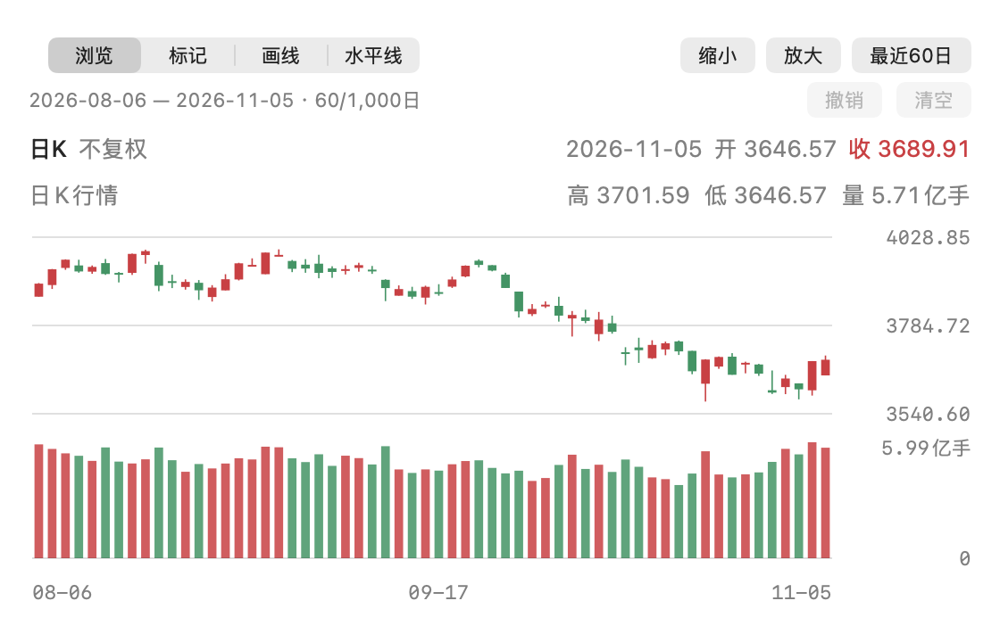

### 9. 竞价、数据缺失与自动重试

开盘竞价期间，个股分时图展示程序实际收到的竞价参考价；09:25后使用成交价，09:30切回正常分时。没有收到的历史点不补画，也不虚构竞价分钟量。

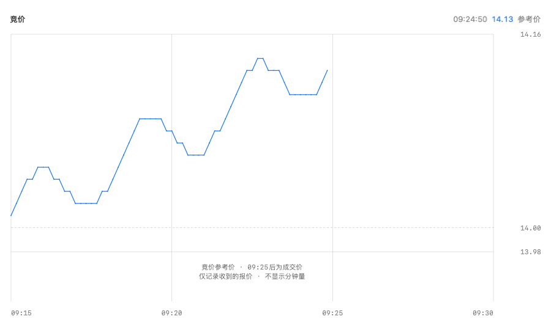

**行情状态：**正常报价直接展示；连接失败时保留并标记上次快照；尚无数据时显示「—」。底栏还会显示报价年龄，连续竞价超过15秒提示「报价过旧」。

| 正常、缓存与缺失状态 | 报价过旧提示 |
| --- | --- |
| 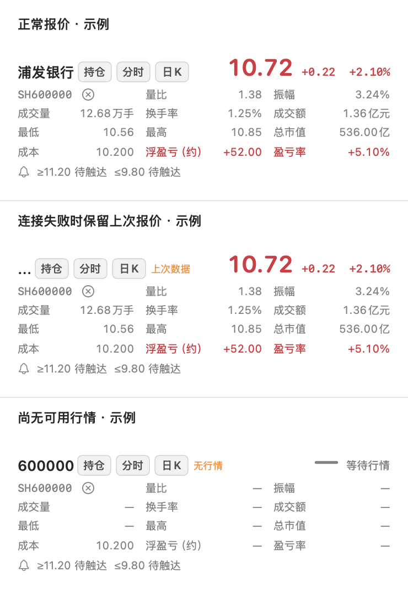 | 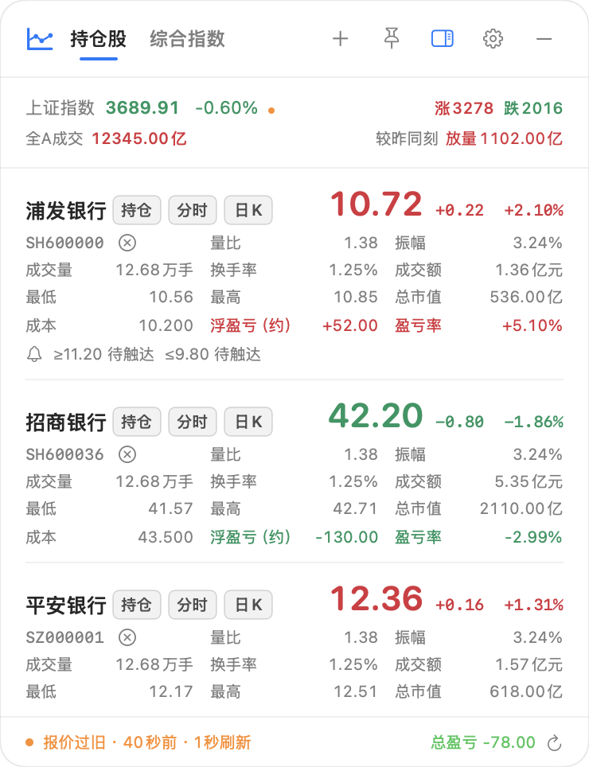 |

**图表加载失败：**显示具体原因并自动重试，不使用假数据替代。


### 10. 右侧自动吸附与菜单栏

默认开启右侧吸附：收起后只留下蓝色「行情」提示条，鼠标移入或点击即可展开，移开后延时收起。输入时保持展开；切到其他应用时收起，未提交输入保留。关闭顶部吸附按钮后，恢复普通浮窗。


菜单栏可重新显示浮窗、添加股票、调整透明度、立即刷新、开关右侧吸附、启用提醒通知或退出。图钉状态、透明度、股票列表、持仓与提醒设置会保存在本机。

## 鼠标与快捷键

| 场景 | 操作 | 结果 |
| --- | --- | --- |
| 股票或指数 | 点击分时／日K | 原位展开、切换或收起图表 |
| 小图绘图区 | 双击 | 居中打开可调整大小的大图 |
| 大日K | 滚轮／触控板捏合 | 按鼠标位置缩放K线数量 |
| 大日K「浏览」 | 按住鼠标左右拖动 | 查看前后历史 |
| 大日K | 点击「最近60日」 | 返回最新60日 |
| 已有线条或标记 | 再次单击，再按 Esc | 删除蓝色选中项 |
| 未完成画线 | Esc | 取消草稿并回到浏览 |
| 标注操作后 | 点击「撤销」 | 恢复上一步，包括删除与清空 |
| 股票输入框 | Enter / Esc | 确认添加 / 收起输入框 |

## 构建与安装

当前源码为 **1.15.1 / build 48**。需要 Apple Silicon Mac、macOS 13或以上，以及 Apple Command Line Tools 提供的 `swiftc`。

```sh
git clone --branch master https://github.com/LingDaoyun/StockDashboard.git
cd StockDashboard/macos
./build.sh
# 从应用菜单退出旧版本后，安装并启用登录自启动
./install-login.sh
```

应用安装到 `~/Applications/A股桌面行情.app`。本机采用 ad hoc 签名，未进行 Apple 开发者公证。

仓库中[历史下载包](downloads/A股桌面行情-macOS.zip)仍为 **1.9.0 / build 30**，不包含本页的新图表功能；使用当前功能请从 `master` 源码构建。

取消自启动但保留应用和数据：

```sh
./uninstall-login.sh
```

完整安装、行情口径、提醒与文件说明见 [macos/README.md](macos/README.md)。本分支当前维护 macOS 客户端。

## 刷新与数据说明

- 交易及开盘准备时段每1秒请求持仓报价，午休30秒、其他休市60秒；大盘独立刷新，交易时约3秒。请求频率不等于行情源更新速度或实际延迟。
- 分时只请求当前展开图；日K载入最近最多1000个交易日，小图显示最后60日。源数据缺失时显示缺失或保留旧快照，并自动重试。
- 行情来自公开接口；程序不连接券商账户。持仓、提醒和图表标注保存在本机。盈亏使用十进制金额计算，不重复扣费。
- 按北京时间交易阶段及内置年度休市表安排刷新；未知年度会提示更新日历。睡眠暂停请求，唤醒后立即刷新。

## 验证

```sh
cd macos
./tests.sh         # 离线解析、持仓、刷新、原生窗口与图表交互测试
./tests.sh --live  # 额外请求公开行情，不保存至持仓
```

包含日K历史与复权解析、鼠标缩放/拖动、标注命中、真实原生组件内选中后 Esc 删除、删除持久化、草稿取消，以及持仓兼容和构建安全测试。
