# A股桌面行情

原生 macOS 菜单栏应用，附带透明毛玻璃桌面浮窗。当前构建适用于 Apple Silicon Mac，macOS 13 或以上。

本文界面图由 **1.15.1／1.16.x** 的原生组件在独立演示环境中生成。持仓、报价、提醒和涨跌停示例使用演示数据；指数日K大图使用公开历史快照，均不代表实时行情或用户账户。完整图片及操作顺序见[功能图册](../README.md#功能图册)。

## 使用

1. 双击同目录上一级的 **A股桌面行情.app**。
2. 首次打开没有默认股票。点击「添加股票」或顶部「＋」，输入框直接出现在「＋」左侧。输入中文证券简称（如「九阳」）后稍停约350毫秒，自动显示名称与代码候选，点击候选追加到下方列表；输入过程中不会自动添加。按回车会查询当前输入，唯一精确匹配或只有一个A股结果时添加；「平安」等多匹配在本窗口选择，不自动猜选第一条。6位股票代码仍按回车添加，可用逗号分隔批量追加，中文名称每次输入一个。已有股票保持原样，Esc收起输入框。
3. 每行代码旁的圆圈叉号将这一只股票移出持仓页；综合指数为固定看板，不提供添加、删除、持仓或提醒编辑。
4. 「右侧自动吸附隐藏」默认开启：启动后自动停靠当前屏幕右侧，滑动收起并留下蓝色「行情」提示条。鼠标移到提示条时滑动展开，离开后约0.6秒收起；窗口有键盘焦点时，输入代码、调整透明度或配置持仓会保持展开。切换其他应用或窗口失焦时滑动收起，未提交输入保留，重新展开后可继续编辑。拖动标题区域可调整高度，松手后继续停靠右侧。菜单栏折线图菜单中点击「右侧自动吸附隐藏」可关闭，恢复自由拖动的普通浮窗；再次点击重新开启。开关状态会保存，重启后保留。图钉按钮切换置顶，减号隐藏浮窗。
5. 顶栏图钉右侧的「右侧吸附」图标可直接开关自动吸附隐藏：蓝色表示开启，灰色表示关闭。点击与菜单栏「右侧自动吸附隐藏」同步，开关状态自动保存。菜单栏折线图图标可以显示浮窗、添加股票、调整背景透明度、立即刷新或退出程序。
6. 点击顶栏齿轮，透明度滑条直接展开在按钮左侧，再点击叉号收起；不打开二级窗口。滑条从0%毛玻璃到100%全透明，默认30%，拖动即时生效并保存；文字保持不透明。股票代码或名称输入支持 ⌘V 粘贴、⌘A 全选。
7. 点击股票名称旁的「持仓」按钮（或股票名称），在该卡片内展开数量、价格与提醒配置。按钮采用与「分时／日K」相同的底色和边框，展开时蓝色高亮。填写后点击「保存成本」；再次点击收起。

标题栏左侧提供「持仓股／综合指数」文字页签，选中项以下划线标识。仅图标及标题栏空白处可拖动浮窗，点击页签时的轻微鼠标移动不会触发吸附收起。启动默认打开持仓股，最多20只；切页时收起编辑和图表。综合指数以两列卡片展示8个指数的点位、涨跌幅、涨跌点数、今日最高和最低：半导体（国证芯片 SZ980017）、科创50（SH000688）、创业板指（SZ399006）、上证指数、深证成指、沪深300、中证500、中证1000。半导体使用[国证半导体芯片指数](https://www.cnindex.com.cn/docs/gz_980017.pdf)，科创50与科创综指不同。指数直接显示行情源点位，不使用个股竞价买卖价；缺失显示“—”，异常或旧数据标橙点并保留上次快照。

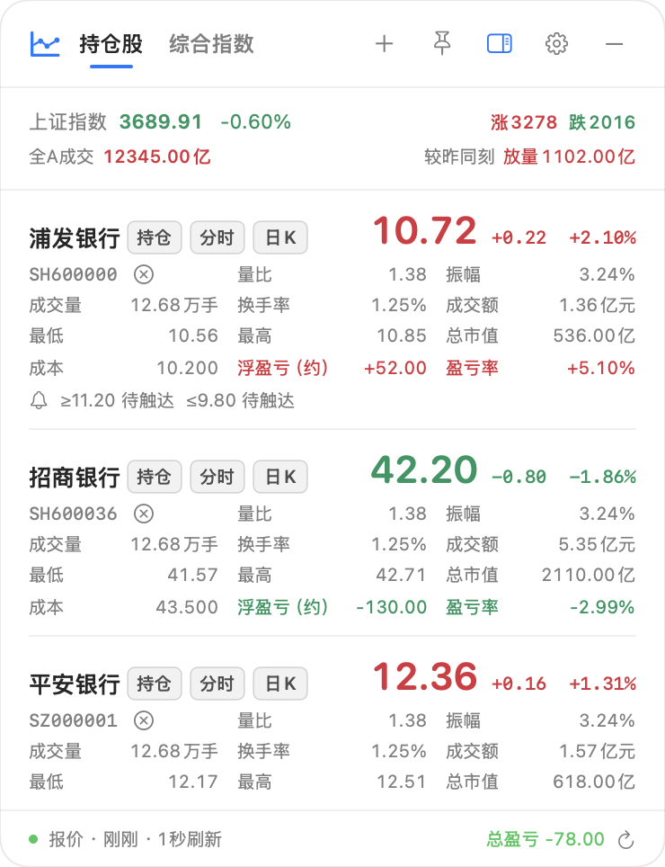
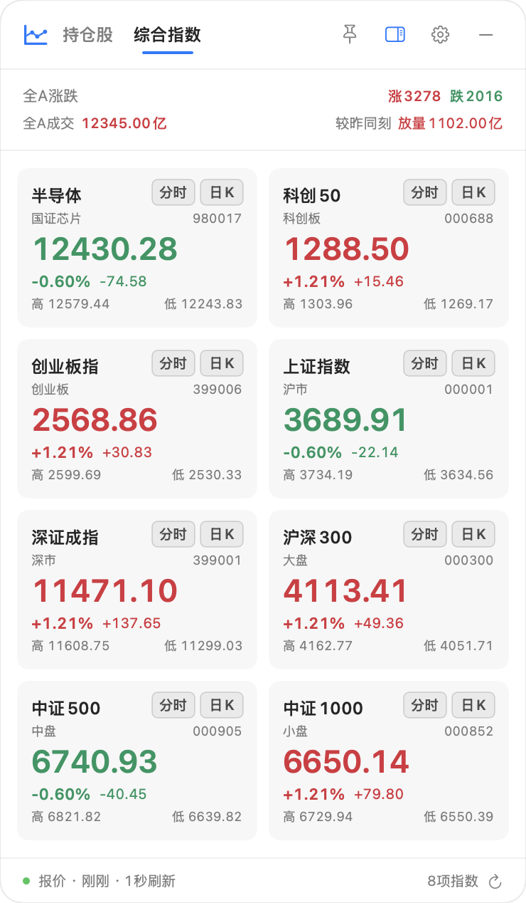

持仓股页查看个股及合计盈亏；切换「综合指数」查看固定的八个指数，卡片上的「分时／日K」按钮用于展开图表。

名称与「持仓／分时／日K」按钮保留稳定宽度，价格和涨跌数字在需要时缩放，避免刷新时名称消失。异常或旧数据以代码旁的橙色状态点提示，悬停读取具体状态；正常时该位置仍保留，避免布局来回跳动。

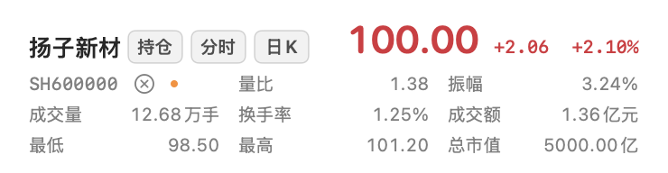

程序保存持仓列表、透明度、置顶设置、自动隐藏开关、位置、买入佣金设置，以及持仓配置和提醒触达状态。旧自选列表与配置继续保留在本地，但不再显示、请求行情或触发提醒。查看综合指数时，8个指数与持仓股票合并去重后按原周期批量刷新；返回持仓页后停止请求额外指数，持仓行情和提醒持续更新。600108、002580仅用于开发测试，不预置到列表。

毛玻璃使用 macOS 原生背景模糊与圆角遮罩，透出桌面或窗口的颜色；文字不透明。100%透明时隐藏背景模糊层，保留1%的极淡点击底色，使空白区域仍可点击和拖动。外观会随系统明暗模式与背景变化。

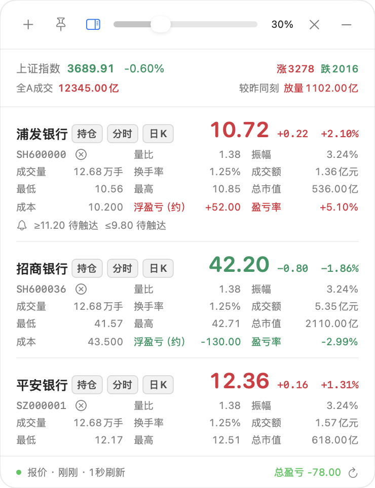

点击齿轮展开滑条，拖动调整背景透明度；文字和控件保持可见、可操作。

右侧吸附以当前屏幕的可用桌面边界为准，避开菜单栏和程序坞；只保存展开位置。蓝色提示条独立于背景透明度，100%透明时仍可找到并展开窗口。应用采用深蓝圆角方形的行情图标，含红绿K线与浅蓝走势。

提示条无需点击，鼠标停在条上即可展开。除系统悬停事件外，开启自动隐藏时每0.1秒检查一次鼠标位置，补上窗口滑动或切换时遗漏的进入、离开事件；关闭自动隐藏或手动隐藏时停止检查。正常顶栏的标题和左侧空白区域支持原生窗口拖动，按钮、代码输入框和透明度滑条各自保持点击操作。

关闭吸附、手动隐藏或重新展开时，会停止尚未完成的滑动动画，避免旧动画继续把窗口推到屏幕外。

失焦时即使鼠标留在原处也会收起，不会被原地悬停立即弹回；重新移入提示条或点击提示条可展开。关闭自动吸附时不强制停靠，手动隐藏后也不会因失焦重新显示提示条。


启用右侧吸附后，移出浮窗可收起为蓝色「行情」提示条；重新悬停提示条可展开。

名称搜索使用[腾讯官网行情页](https://gu.qq.com/sh600108)当前的智能搜索接口，名称输入停止约350毫秒后发出查询，回车可立即查询确认；过滤基金、指数及港美股结果。候选列表与输入框同宽，直接浮在其下方，覆盖部分卡片但不占用布局空间，不另开窗口或显示选择标题；较多候选可滚动。改字或收起输入时取消未完成搜索，过时结果不会更新列表。查不到、断网或服务异常会在原底栏提示，保留输入供修改或重试。接口支持中文证券简称，不保证识别公司工商全名；当前北交所名称覆盖有限，仍可输入代码添加。搜索只发送查询词，不发送持仓金额、股数或费用；卡片内容和常态窗口高度不变。

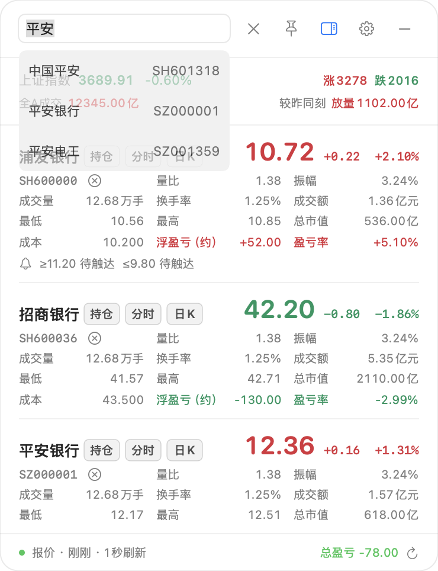

点击「＋」输入中文简称，在下方候选中确认证券；输入六位代码可按回车添加。

## 大盘概览

顶栏下方固定显示两行大盘信息：持仓页展示上证指数点位及涨跌幅、沪深京全A涨跌家数、当日累计成交额，以及较上一交易日同一时刻的放量/缩量金额。综合指数页的顶部仅保留全A涨跌家数、成交额和同刻放量/缩量，上证指数在下方卡片中展示。没有持仓股也会显示；大盘不计入20只持仓上限或持仓盈亏。

当前成交金额及同刻变化金额按同一方向着色：放量红色、缩量绿色；持平或比较不可用时保持中性色。

上证指数来自腾讯公开行情；全A家数使用同花顺「同花顺全A(沪深京)」，成交额和同刻差额使用[同花顺首页](https://www.10jqka.com.cn/)的公开成交额数据。当前金额与差额成对取自同一响应，不与昨日全天成交额比较，也不跨数据源拼接成交额。缺少有效同刻基数时显示“—”，保留可用的当日成交额。

交易及开盘准备时段大盘每3秒请求，午休30秒、其他休市时段60秒，独立于个股每秒请求；手动刷新与唤醒立即请求。在途请求不叠加，失败保留上次快照并在下一轮自动重试，顶部橙点及悬停提示说明异常。超过15秒的交易时段旧数据也会提示。鼠标悬停大盘可看源时间、统计总家数和同刻基数；同花顺分时分钟标签可能取整至下一分钟，时效使用响应实际更新时间判断。

## 分时图、日K与成交量

双击股票或指数的日K、分时绘图区，可在当前屏幕中央打开更大的悬浮图表。大图可拖动、调整大小并保持行情更新；悬停仍显示所选时间、价格、高低和成交量。关闭大图不收起小图；切换当前证券或图表类型时大图同步切换，收起小图或切换页签时大图关闭。

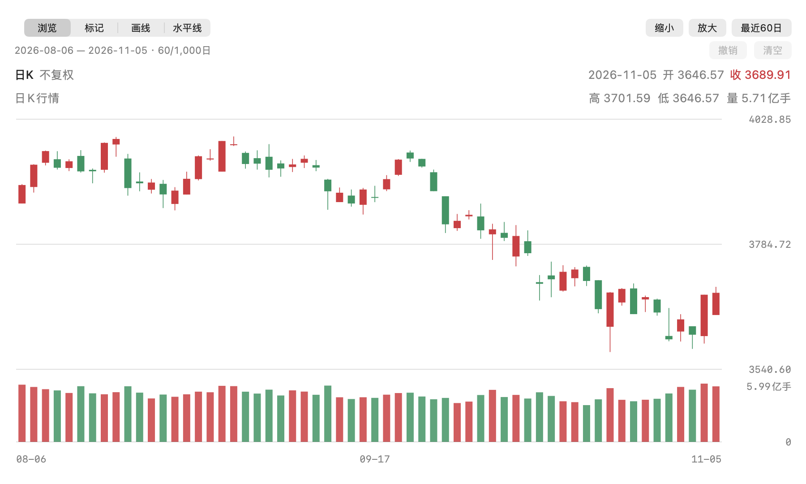

双击日K绘图区打开大图。初始显示最近60根，工具栏同时显示当前可见数量与实际载入数量。

日K大图默认展示最近60个交易日。在绘图区向上滚轮放大、向下滚轮缩小，缩放以鼠标所在日期为中心；触控板也可捏合缩放。在「浏览」模式按住鼠标左右拖动查看历史，「最近60日」返回最新。工具栏显示当前可见日期和实际载入根数，最多查看1000根日K，证券上市时间或行情源覆盖不足时按实际数据展示。

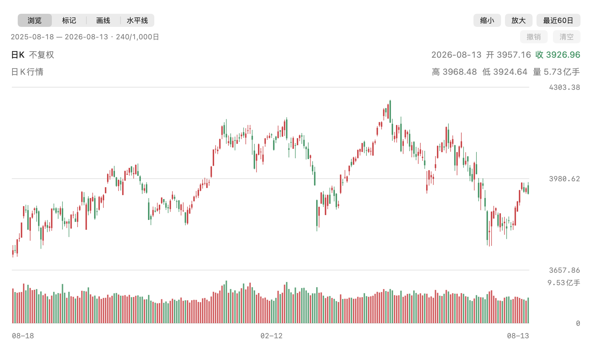

向下滚轮缩小以查看更长历史，再拖动平移；点击「最近60日」回到最新范围。

日K大图提供「标记」「画线」「水平线」：标记在点击的日期、价格位置落点；画线依次点击两个端点；水平线点击一次确定价格。再次点击已有标记或线条，会以蓝色高亮选中，按Esc只删除该项；点击空白可取消选择。画线未完成时Esc取消草稿并回到浏览；没有选中项时Esc只退出绘图，不删除其他标注。「撤销」退回上一次标注操作，也可恢复刚删除或清空的标注；「清空」只清当前证券、当前复权口径下的标注。已完成标注自动保存在本机，重开大图仍保留；按日期和价格定位，缩放、拖动不改变标注数值。前复权历史价格会随行情源重新计算，标注保留创建时的价格。

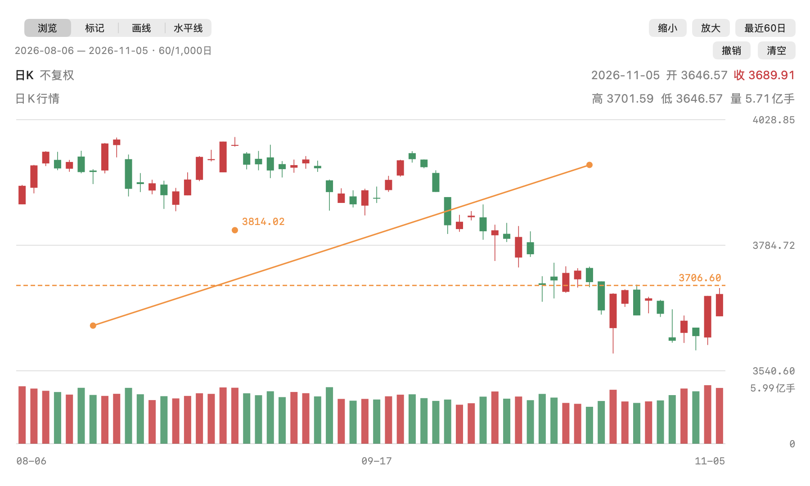

「标记」点击一次落点，「画线」依次点击两个端点，「水平线」点击一次确定价格。

绘图时显示横、竖两条虚线，交叉点对齐鼠标在价格区的实际位置。横线用于定位价格，竖线用于定位日期；移出价格区或切回浏览后横线消失。

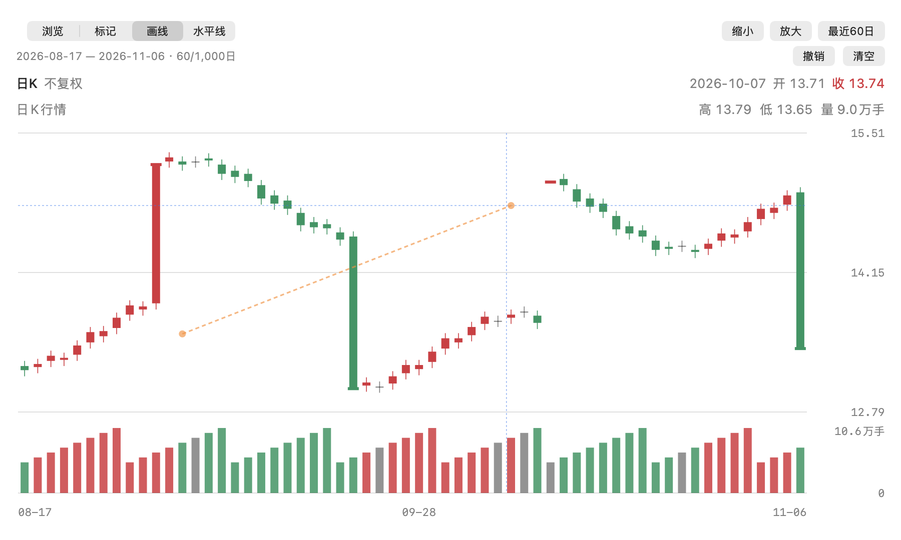

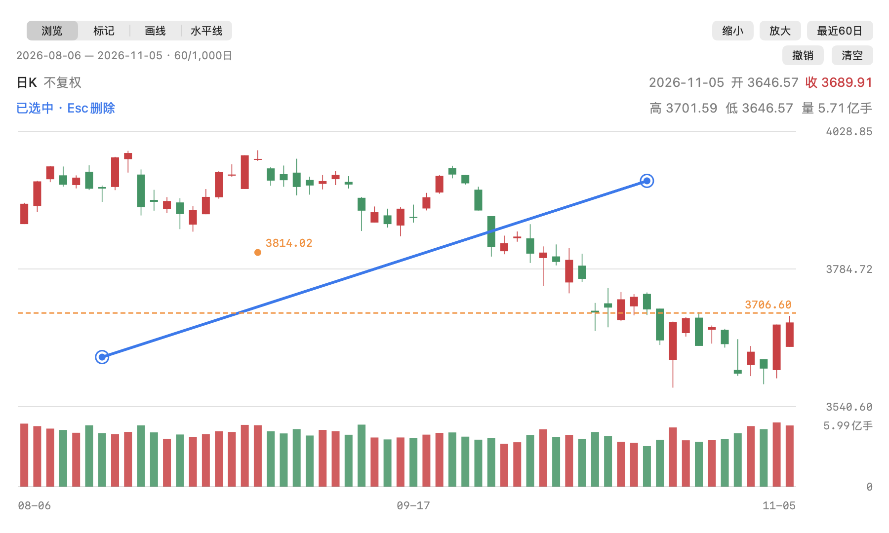

点击已有标记或线条，确认蓝色选中提示后按Esc删除这一项；未完成的线稿则由Esc取消。删除后可用「撤销」恢复。

持仓股票名称这一行按「持仓／分时／日K」并排显示按钮，综合指数卡片右上角提供「分时／日K」按钮；「分时／日K」均有浅色底和边框，当前展开项蓝色高亮。点击在原分时区域展开日K，再点同一按钮收起；同一证券的分时与日K直接切换，点击其他证券替换当前图，一次只展开一张。日K与分时高度相同，沿用自动滚动、切页收起及删除时取消请求的交互。

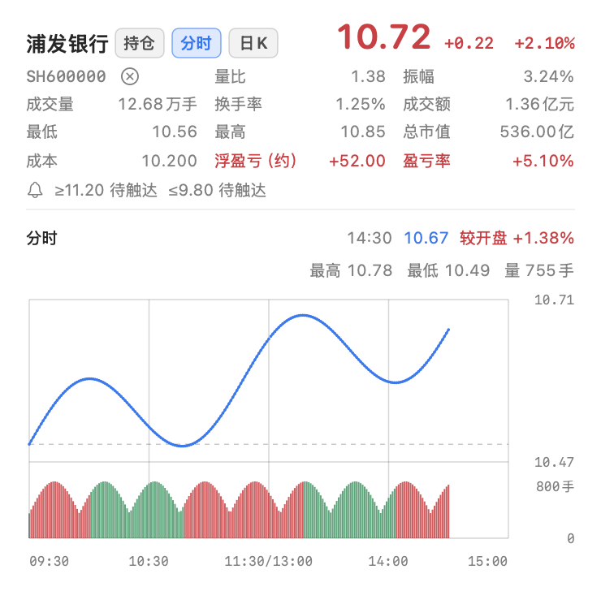
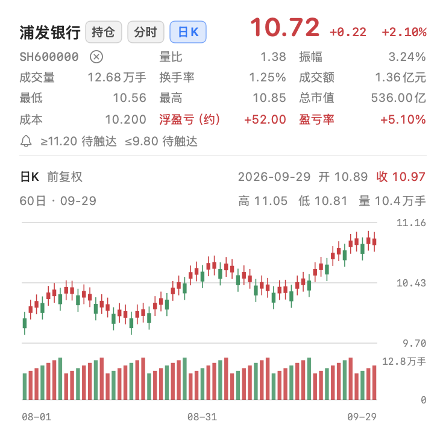

在「分时／日K」之间切换，图表沿用同一展开区域；再次点击当前按钮收起。

日K从腾讯接口载入最近最多1000个交易日，小图固定展示最近60日，大图按缩放范围展示。蜡烛为开、高、低、收，下方为每日成交量（手），按收盘相对开盘红涨绿跌。鼠标悬停查看该日数值，移开显示当前可见范围的最后一日；界面注明复权口径、交易日数与日期范围。当日未收盘K线会继续变化。优先使用前复权数据；接口只返回普通日线时明确显示「不复权」，不混合两种价格。

1.18.0将分时与日K请求切换到腾讯官网使用的公开入口 `proxy.finance.qq.com/ifzqgtimg`，修复旧入口返回HTTP 501导致的加载失败。日K前复权与原价数据使用同一入口，数量、复权和涨跌停标识校验保持一致。

仅当前展开的日K发出请求，交易与午休约30秒、其他休市60秒；手动刷新和唤醒立即请求。请求不叠加，切换/收起/切页/删除时取消，晚到回包不会覆盖当前图。失败保留上次快照并显示提示；悬停只显示所选交易日的日期、开高低收和成交量。


没有可用数据时显示原因并自动重试；已有快照时保留上次图表，不用虚构数据填充。

综合指数页点击任意指数卡片或其「分时」按钮，可在该行下方展开横跨两列的分时图；再点一次或点击图旁的关闭按钮收起，点击另一指数切换。一次只展示一张图，展开后自动滚到走势图，仍可滚动查看其他指数。复用价格走势、昨收参考线、分钟成交量及悬停读数；仅当前展开的指数请求分钟数据，收起或切换页签即取消。指数始终使用分钟接口，不采样个股买卖盘口作为竞价走势；当日分时尚未生成时显示缺失或旧交易日提示。

每只股票名称旁的「分时」按钮可在原卡片内展开或收起「价格走势＋分钟成交量」；默认收起，一次只展开一只。切换其他股票会收起前图，开持仓配置时也会收起图。开图后自动滚到对应卡片，超过窗口高度仍可在原列表滚动；双击绘图区另开大图。图表与持仓盈亏计算独立。

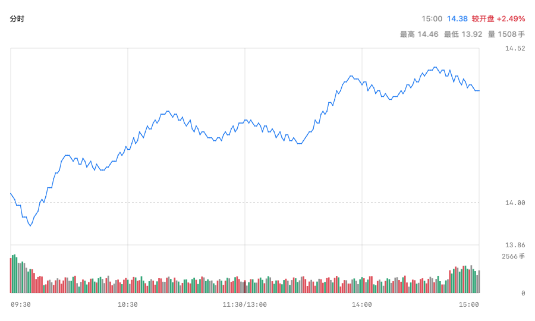

双击分时绘图区放大查看，悬停某分钟可读取对应价格、涨跌幅和分钟量。

分时小图和大图按昨收价每隔2个百分点绘制水平虚线：0%昨收线加深，正向红色、负向绿色。仅绘制当前纵轴范围内的刻度；范围不足2%时可能只有0%线。小图跨度较大时省略过密的百分比文字，仍保留每2%的虚线。刻度相对昨收计算，与顶部「较开盘」的基准不同。

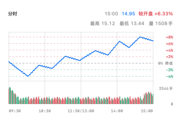
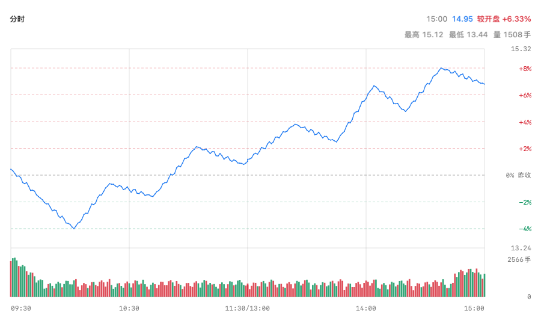

持仓个股在开盘竞价期间自动显示09:15–09:30价格曲线：09:15–09:25优先采样有效买一、买一缺失时取卖一；09:25–09:30改用实际成交价；09:30自动切回普通分时。复用持仓股原有每秒报价请求，图表收起时也记录，不增加网络请求。数据只在当前进程内保留当日实际收到的源时间点；未运行、断线、盘口无有效价的部分不补造，超过15秒的采样缺口断线，旧报价提示。竞价阶段不画分钟量柱，避免把虚拟撮合量当成已成交量；未收到有效当日报价时明确显示等待，不拿昨图或昨收冒充竞价走势。

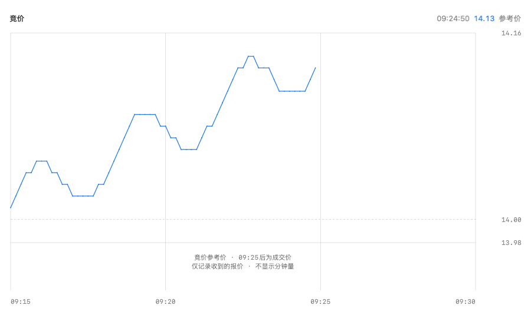

竞价图只展示实际收到的参考价采样；此图为演示数据，不是当日竞价记录。

公开分钟接口未提供完整竞价历史。09:25–09:29可能提前返回标记09:30的开盘成交点，现仅对这一已核实边界放行，真实源时间仍保留；其他未来分钟和乱序校验不变。

收盘后仍可查看当天09:30–15:00的正常时段分时。接口附带的15:00后至15:30尾段经校验后排除，不会导致当天曲线整包失败，也不会把尾段量并入15:00量柱。

日K与分时网格线采用更深的灰色并加粗，便于对照刻度。上方蓝线为分时价格，水平虚线每隔2个百分点、0%为昨收，下方红绿柱为分钟成交量（手）；红绿按该点价格相对上一点的涨跌着色，不代表主动买卖量。鼠标悬停图内可查看对应时间、价格、较开盘涨跌幅和分钟量；离开后恢复最新点。较开盘＝（该点价格－当日开盘价）÷当日开盘价×100%，红涨绿跌，保留两位小数；开盘价取同一分时响应的报价字段，缺失或无效时显示“—”，竞价图不显示。最高、最低和分钟量位于第二行，图表总高度保持不变。午休在横轴压缩，11:30和13:00共用中间刻度。

分时来自腾讯公开分钟接口，沪、深、北交所均已用真实响应核对。接口量为累计成交量，量柱按相邻点差分；缺失分钟时不把多分钟累计差额当单分钟，缺量不绘制假零柱，价格缺点处断线。09:30首点沿用接口量，竞价量的细分归属未核验。最后分钟标签可能取区间末端或下一分钟，仍可能更新；真实时效取同包报价源时间，不把分钟标签当未来源时间。

普通分时仅当前展开的图请求，交易时约3秒、午休30秒、其他休市60秒；与个股和大盘请求互不阻塞。在途不叠加，切换/收起/删除时取消旧请求，已取消的晚到回包不覆盖新图；睡眠暂停，唤醒立即请求。失败保留最近快照并自动重试，源时间异常或旧交易日通过橙点及悬停提示说明。悬停浮层只显示所选点的交易日、时间、价格、当日最高最低和分钟量；不展示操作说明。刷新频率不代表上游逐tick实时性。

### 日K涨跌停标识

从1.16.0起，看板缩略图和双击打开的大图均在涨停K线最高处画红色粗横线、跌停K线最低处画绿色粗横线。一字板也显示，缩放时横线限制在对应K线的间距内。顶部最新/悬停读数与悬停提示同步显示「涨停／跌停」，不改变原有蜡烛颜色、画线与Esc删除操作。

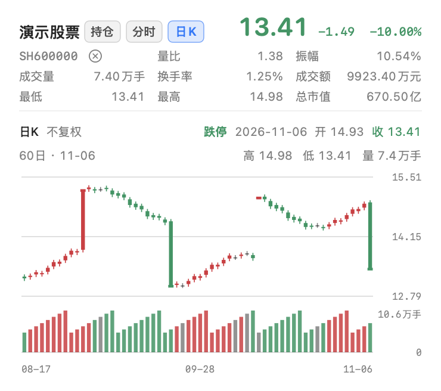
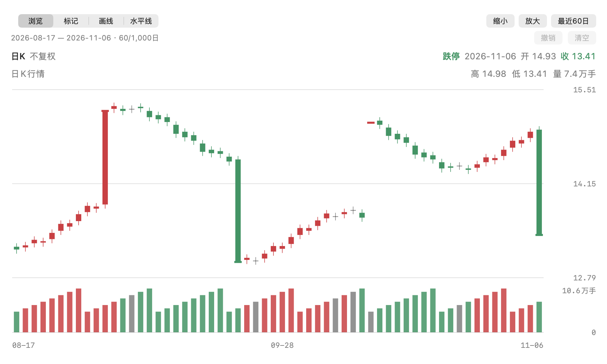

- 按收盘价封在涨跌停价识别；当日未收盘K线使用最新价，打开涨跌停后标识随刷新移除。仅盘中最高/最低触及不算封板。
- 当前报价日优先使用腾讯同包的涨停价/跌停价，且日期、最新价须与尾K一致。历史标识用不复权价格判断，再按交易日映射到前复权图，不在前复权价格上直接套百分比。
- 历史按沪深主板10%、科创/创业板20%、北交所30%的常规规则和分位取整识别，并检查整根OHLC未越过限价。指数、未知类型、无成交、缺基准、除权附加记录及原始历史前5条保守不标。原始数据请求失败时保留正常图表，相关历史标识留空。
- 行情源未提供逐日历史ST身份及特殊交易日状态，因此不按当前名称追溯旧5%限幅；2026-07-06以前的主板5%涨跌停不推断。历史重新上市等无涨跌幅限制的特殊日期无法完整排除，历史标识属于按常规规则识别，不能视作交易所逐日状态确认。[上交所2026规则及实施日期](https://www.sse.com.cn/lawandrules/sselawsrules2025/trade/universal/c/c_20260424_10816492.shtml)

## 持仓与价格提醒

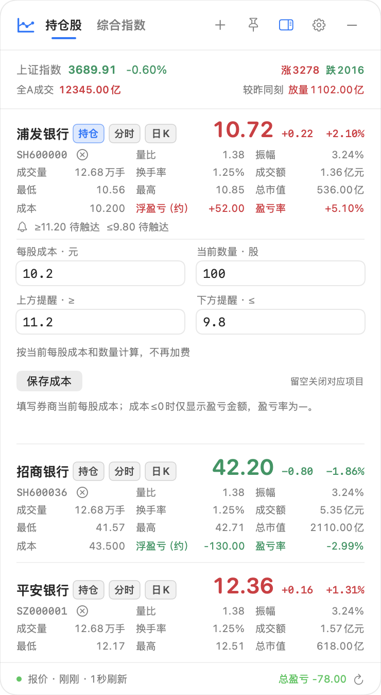

填写「每股成本」和「当前数量」，按需设置上下提醒价，点击「保存成本」一并保存；不再另加手续费。

卖出后，将鼠标移到「浮盈亏」区域，标签位置会显示带垃圾桶图标的「清除」按钮。按钮默认隐藏，移开后恢复标签，金额和其他列的位置保持不变。点击后清空该股成本和股数，立即更新总盈亏；股票行情、分时／日K及价格提醒继续保留，清除结果保存到本机。

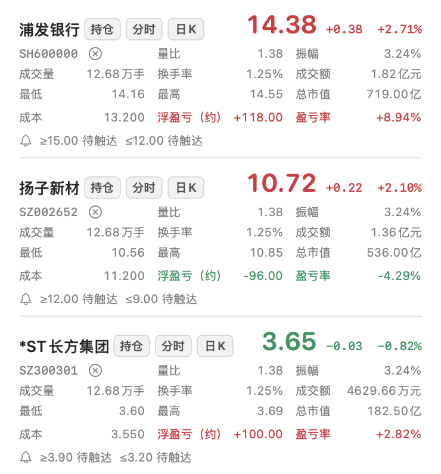

| 悬浮显示清除按钮 | 清除后 |
| --- | --- |
| 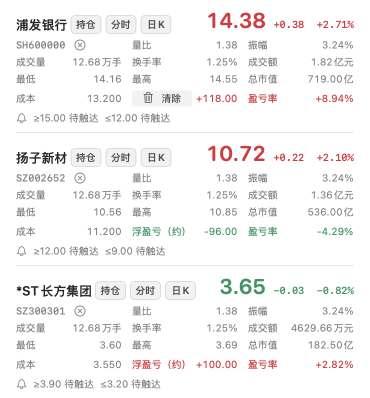 | 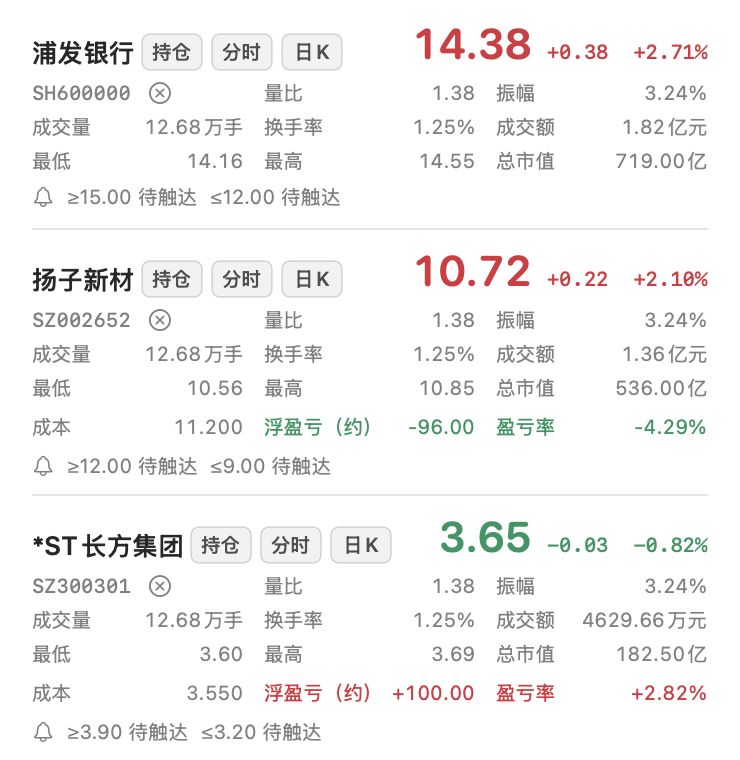 |

- 点击「持仓」按钮或股票名称，在卡片内填写「每股成本 · 元」与「当前数量 · 股」。仅保留这一种录入方式，不再提供总成本、买入金额切换或佣金输入。上方、下方价格提醒独立设置。
- 每股成本填写券商当前显示的已含费用成本，最多8位小数；股数为正整数。按（现价−每股成本）×股数计算，不再加费。零或负成本仍计算盈亏金额，盈亏率显示“—”。
- 成本与股数需同时填写或同时留空；同时留空并保存可清除持仓，提醒字段仍独立保留。卡片三位成本仅用于展示，输入框保留已保存单价的完整精度。
- 旧版总成本或买入金额记录继续保留，打开时换算为最多8位小数的每股成本。只打开或成本、股数未改动时保存提醒，不会用显示舍入值改写原始总成本，也不会重新加费；修改成本或股数后按新单价保存。
- 卡片标注「浮盈亏（约）」：浮盈亏＝卡片显示价格×持仓股数−总成本，盈亏率＝浮盈亏÷总成本×100%。行情跳动和数据更新时间不同，金额仅供参考。集合竞价期间用下述买一优先、卖一兜底的参考价，其余阶段用成交价。金额用十进制计算，显示时按分四舍五入；总成本已含费用，不另外重复扣费。程序不连接券商账户，也不估算未来卖出费用。
- 持仓页底部报价状态右侧显示「总盈亏」（元），只汇总持仓股中已填写持仓的卡片，随行情刷新、保存持仓及删除股票更新，红盈绿亏。指数页右侧显示指数数量，不计入持仓盈亏。无持仓时总盈亏为0.00；持仓首次尚无报价或配置无法读取时显示“—”；连接失败时沿用缓存报价并提示。
- 上方提醒价在现价达到或超过该价格时触发，下方提醒价在现价达到或低于该价格时触发。可以只设一个方向；两个方向均设置时，下方价须小于上方价。价格需大于0，字段留空并保存即可关闭对应提醒。
- 每个方向只提醒一次。修改对应提醒价会重置该方向；仅修改成本或股数不会重置已触达状态。已触达后，可点击「重新启用提醒」，保留原提醒价并重新等待触达。
- 加载保存的配置时会重新校验数值、持仓字段配对与上下提醒价关系。异常配置暂停用于盈亏和提醒，代码旁的橙色状态点提示「配置异常」；点击股票名称可用原字段修正，原数据不会因编辑其他股票而被删除。只修正持仓仍保留未变更阈值的已提醒状态。
- 配置逐条读取：某条JSON字段类型损坏时保留原字段，不影响其他合法持仓；重新保存或删除对应股票后解除提示。整个存储无法读取时，将原数据保存在本机设置的 `stockTrackingCorruptBackup`，底栏持续提示核对重新录入，重新录入后的正常重启解除提示。备份和持仓均不上传。
- 仅使用提醒启用或阈值修改之后产生、且距当前不超过30秒的行情源报价判断提醒。旧快照不会触发，也不会消耗提醒机会。已触达状态会保存，重启不会对同一条件重复提醒。
- 成交价提醒在集合竞价期间暂停、不消耗提醒机会；竞价结束后按原阈值和时效条件恢复。源时间仍落在竞价期间的晚到包也不触发，避免把竞价参考价或旧成交价当成已成交价格提醒。
- 正常模式下，macOS 授权通知后会发送系统通知；触达时也会在卡片显示已提醒标记并响铃。菜单栏提供「启用提醒通知」，无需填写提醒价即可申请授权。若此前拒绝了权限，在「系统设置 → 通知 → A股桌面行情」打开「允许通知」，并选择横幅或提醒样式。系统通知未开启时，卡片标记与响铃仍可使用。临时界面预览不响铃、不申请通知权限。

## 行情含义

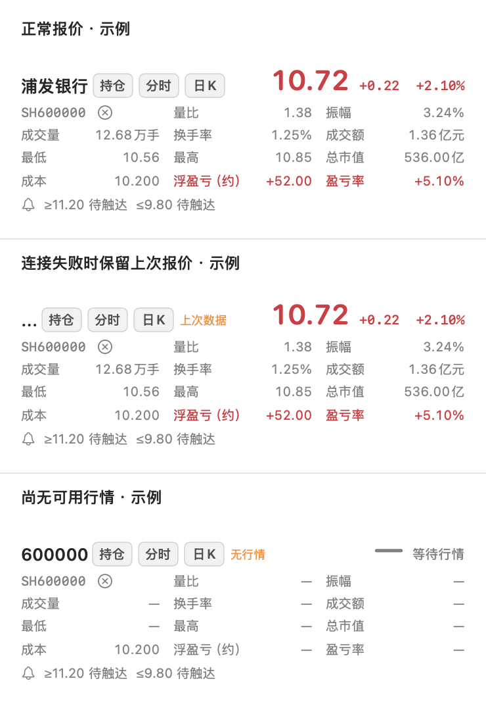
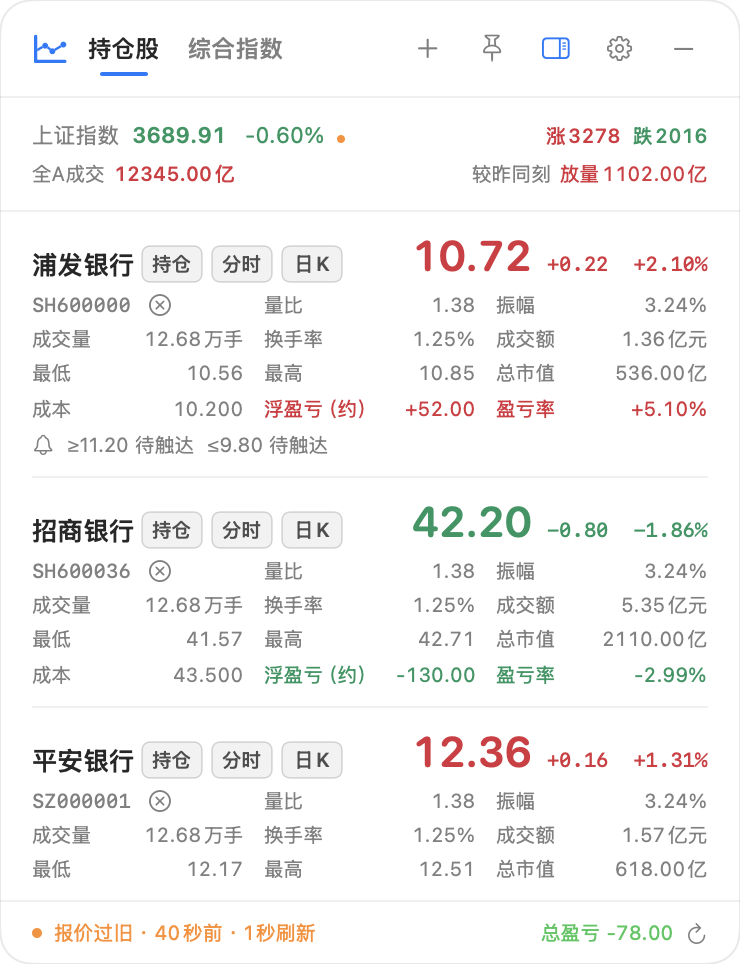

底栏说明源报价年龄和刷新状态；橙色提示用于过旧或异常数据，不能把请求成功等同于报价实时更新。

- 按北京时间及[交易所2026年休市安排](https://www.sse.com.cn/disclosure/announcement/general/c/c_20251222_10802507.shtml)调整轮询。交易日09:14–11:31及12:59–15:31每1秒批量请求一次，包含开盘准备、竞价和收盘快照宽限；11:31–12:59午休每30秒，其他时段、周末和节假日每60秒。交易时段参考[2026交易规则](https://www.sse.com.cn/lawandrules/sselawsrules2025/stocks/exchange/c/c_20260424_10816482.shtml)。调休周末仍休市。
- 使用单个一次性定时器，在下次轮询或时段边界中较早的一刻触发，开盘前恢复每秒请求；不在休市期间每秒唤醒。2026以外的年度休市表尚未确认，工作日保留每秒轮询并提示「日历待更新」，周末仍降频。每年须更新休市表，不能用普通工作日规则推定节假日。
- 同一个客户端持续复用无缓存网络会话，减少重复建连开销；请求未完成时跳过下一个周期，避免积压。单次请求超时为6秒。启动、增删股票、手动刷新和唤醒立即请求；没有持仓股且未打开指数页时，仅保留大盘定时请求。
- 服务端关闭连接、断网或请求超时后，保留并标记上次行情，后续轮询持续自动重试；网络恢复时由新请求重新建立连接，收到可用响应后解除连接失败提示。无需手动刷新或重启程序。睡眠时暂停并取消在途请求，唤醒立即请求；取消不会冒充网络故障。
- 1秒是本机请求周期，无法控制公开行情源的更新、缓存和转发延迟。是否接近同花顺或东方财富、能否只差1–2秒须在交易时段同步对照实测，不能用请求耗时或休市快照证明。
- 紧凑卡片展示现价、涨跌额、涨跌幅、量比、日内振幅、当日累计成交量、换手率和当日累计成交额；每张卡片不单独显示时间。
- 已确认交易日09:15–09:25开盘集合竞价、14:57–15:00收盘集合竞价期间，现有价格、涨跌额/幅、浮盈亏/盈亏率及总盈亏使用同一参考价：优先取腾讯买一价（0基字段9），没有有效买一时取卖一价（字段19）。字段映射已与[腾讯官网行情页](https://gu.qq.com/sh600108)的五档组件核对；竞价中买卖价格承载虚拟撮合参考价的含义参考[交易所接口说明](https://www.sse.com.cn/services/tradingtech/development/c/10822594/files/2096257019bf484f9b9935fa73f94721.pdf)。不增加买一/卖一行或徽标，卡片高度不变，口径说明放在既有价格和底栏的悬停提示中。
- 零、负数、缺失及非有限的买卖价均不可用于估值。双侧均无有效价时，竞价价格与盈亏显示“—”，底栏提示缺失并继续自动刷新；有持仓缺估值价时总盈亏显示“—”。09:25开盘集合竞价结束、15:00收盘集合竞价结束后恢复接口成交价，不沿用竞价价。成交量和成交额仍为当日已成交累计，不作为虚拟匹配量。
- 竞价价随申报变化，仅用于试撮合估值，最终以成交价为准；不保证与同花顺同一tick或相同上游延迟。底栏源报价年龄和已有断线提示仍保留。
- 量比（倍）和日内振幅（百分比）位于代码行；换手率（百分比）位于量额行，均直接采用行情源数值。指标缺失或无效时显示“—”，其他行情仍保留。
- 持仓股量额行下方显示对齐的「最低／最高／总市值」。最高、最低为行情源返回的当日最高价和最低价，随现价同步刷新，不依赖打开分时图，也不使用程序启动后收到的价格自行累积；休市时显示最新交易日快照。总市值仍使用公司全部股份口径，以「亿／万亿」人民币显示。缺失、无效或源零值显示“—”，不影响其他行情；复用原行情请求，卡片高度不变。
- 价格单位为元；成交量单位为手（1手=100股）；成交额以元、万元或亿元显示。量额均为当日累计，非本次刷新的增量。
- 红涨绿跌。底部显示最旧一条源报价距今多久，例如「报价 · 3秒前 · 1秒刷新」。仅连续竞价时超过15秒显示橙色「报价过旧」；盘前、竞价、午休、盘后和其他休市时段明确标为快照，采用中性状态，不把收到旧快照当作实时更新。慢请求期间年龄仍随时钟更新。鼠标悬停可看完整源报价时间、最近接收时间及当前周期。
- 报价年龄是行情源时间距今，不是网络延迟；停牌或无新成交也可能使其变旧。「报价过旧」仅提示当前数据时效，不推断行情源故障或交易决策。
- 公开行情可能有延迟。休市、停牌或已退市证券可能仍返回最近快照，返回报价不能证明证券正在交易。
- 连接失败时保留上次数据并显示橙色提示；缺失报价会提示无可用行情，不用零值冒充报价。
- 同一响应有重复证券时采用源时间最新的快照；比缓存更旧、或比本机接收时间超前5秒以上的报价会被拒绝并标记异常，保留已有行情，也不触发提醒。相同源时间的有效字段仍可更新。
- 电脑睡眠时暂停，唤醒后立即请求。

## 登录自启动

先从 app 菜单选择「退出」，然后在本文件所在目录执行：

```sh
./install-login.sh
```

脚本把上一级已构建的 app 安装到 `~/Applications/A股桌面行情.app`，启用当前用户登录后的自启动，并立即打开安装路径。使用 `~/Library/LaunchAgents/cn.local.AShareDesktop.login.plist` 和 `/usr/bin/open -g -a`，通过 LaunchServices 打开同一 app；没有 KeepAlive，不会在退出后强制重开。股票列表、透明度、置顶、位置、持仓和提醒触达状态继续使用同一设置域，不会被清空。

可重复执行；内容一致时保留安装，仅重新启用启动项。需要更新时请先正常退出。最终替换失败会尝试恢复旧应用，恢复本身失败时原备份仍保留。成功安装并加载启动项后，旧版压缩为ZIP再移除松散app，避免重复应用图标；归档失败保留旧app并提示。未知同名app或符号链接拒绝覆盖。设置加载与当前启动可以验证，但本次安装不等于实测了重新登录或整机重启。

取消自启动：

```sh
./uninstall-login.sh
```

此操作仅移除登录启动项，保留 app 和设置。

## 从源码构建

需要 Apple Command Line Tools（提供 swiftc）。在本文件所在目录执行：

```sh
./build.sh
```

应用输出到源码目录的上一级。构建先在新临时目录完成编译和签名，成功后备份并替换原app，旧构建同样改为ZIP压缩备份；拒绝输出路径的符号链接和同名其他程序，编译或签名失败保留原app。构建脚本执行本机ad hoc签名；此交付没有Apple开发者公证。

行情解析、代码校验、持仓与提醒、日K缩放和标注命中、原生鼠标事件与Esc删除、贴边位置计算和滑动动画测试（使用独立测试窗口和设置）：

```sh
./tests.sh
```

实时测试（只请求测试股票，不保存持仓）：

```sh
./tests.sh --live
```

临时界面预览（独立临时设置，退出后移除）：

```sh
../A股桌面行情.app/Contents/MacOS/AShareDesktop --preview '600108,002580'
```

## 文件

- `Sources/Quotes.swift`：股票代码、行情与买一/卖一价格解析、竞价估值选择和HTTPS客户端。
- `Sources/StockSearch.swift`：腾讯名称搜索、A股候选过滤与唯一匹配规则。
- `Sources/Intraday.swift`：分时价格、分钟量差分及独立HTTPS客户端。
- `Sources/IntradayChartView.swift`：原生价格/量柱图与悬停数值。
- `Sources/DailyKLine.swift`、`Sources/DailyKLineChartView.swift`：最多1000根腾讯日K的解析与请求、蜡烛/日量图、缩放绘图和标注选择删除。
- `Sources/DailyChartWorkspace.swift`：按日期定位的视窗、标注命中检测，以及按证券和复权口径隔离的本地标注存储。
- `Sources/DailyChartInteraction.swift`：图表局部鼠标、滚轮、捏合和Esc事件转发。
- `Sources/ExpandedChart.swift`：分时与日K大图窗口、尺寸调整和证券切换同步。
- `Sources/IndexDashboard.swift`：八指数卡片看板及行内图表展开。
- `Sources/MarketOverview.swift`：全A涨跌家数、成交额同刻比较与上证指数的独立HTTPS客户端。
- `Sources/MarketOverviewView.swift`：顶栏下方两行大盘信息及源时间提示。
- `Sources/MarketClock.swift`：北京时间交易阶段、年度休市表、请求周期和报价年龄。
- `Sources/DesktopApp.swift`：浮窗、设置、菜单栏、定时请求和本地设置。
- `Sources/Tracking.swift`：十进制持仓总成本与盈亏、输入校验和一次性价格提醒判断。
- `Sources/Fees.swift`：单笔买入委托费用预估，按可配置佣金万分比与最低佣金计算。
- `Sources/TrackingViews.swift`：卡片内的持仓与提醒配置界面。
- `Sources/EdgeGeometry.swift`：四边吸附、收起位置和提示条位置计算。
- `Sources/EdgeDocking.swift`：鼠标悬停、收起与展开动画。
- `Sources/WindowDragging.swift`：顶栏原生窗口拖动区域。
- `Sources/main.swift`：应用入口。
- `Tests/QuoteTests.swift`：行情解析与代码输入校验。
- `Tests/WatchlistTests.swift`：增量添加、删除、去重、上限、设置恢复、报价时序和异常持仓配置隔离与修正。
- `Tests/TotalProfitTests.swift`：持仓合计、费用、无持仓、缺行情、动态修改和损坏配置下的金额显示，以及竞价估值、阶段切换和提醒暂停恢复。
- `Tests/MarketClockTests.swift`：交易时段边界、节假日、调休周末、未知年度、时区独立和报价年龄。
- `Tests/RefreshTests.swift`：实际每秒轮询、休市降频与开盘切换、批量请求、慢网络不重叠与年龄更新、暂停唤醒、断线重试与缓存保留，使用本地模拟响应和独立时钟。
- `Tests/StockSearchTests.swift`：中文名称、歧义、证券过滤、URL编码、网络异常及取消的隔离回归。
- `Tests/IntradayTests.swift`、`Tests/IntradayRefreshTests.swift`：分钟单位、日期、缺点、差分、取消、断线恢复与单图刷新隔离。
- `Tests/DailyKLineTests.swift`、`Tests/DailyKLineRefreshTests.swift`：复权与OHLC解析、真实源时间、单图切换、取消、冷却和缓存保留；`--live`另验证8指数与沪深北示例。
- `Tests/DailyChartWorkspaceTests.swift`：缩放锚点、历史平移、标注命中和本地存储隔离。
- `Tests/DailyChartInteractionTests.swift`：原生坐标翻转、点击与拖动、滚轮方向、快速两点画线及Esc事件。
- `Tests/DailyChartSelectionTests.swift`：实际SwiftUI图表中选中旧标注后Esc精确删除、工具切换、草稿取消及持久化恢复。
- `Tests/ExpandedChartWindowTests.swift`：大图显示、关闭、切换证券和图表类型的原生窗口行为。
- `Tests/PerShareEntryTests.swift`：单一每股成本录入、旧成本兼容及提醒保存隔离。
- `Tests/StockListTests.swift`：持仓与指数页切换、列表过滤和展开图表行为。
- `Tests/ListLayoutTests.swift`：真实原生窗口中8／20只股票的滚动、图表及持仓编辑展开收起、指数页切换；后台超时检测主线程布局卡死，使用隔离设置且不联网。
- `Tests/MarketOverviewTests.swift`：全A字段、同刻成交额口径、源时间、无效数据与网络恢复。
- `Tests/MarketRefreshTests.swift`：大盘独立刷新、空自选、断线重试、暂停唤醒及持仓隔离。
- `Tests/QuoteClientTests.swift`：会话生命周期复用、无缓存、请求错误、取消及断线后恢复，使用本地模拟响应。
- `Tests/BuildSafetyTests.sh`：输出符号链接、同名其他程序、失败保留与临时目录清理，使用隔离目录和模拟编译器。
- `Tests/TrackingTests.swift`：持仓盈亏、价格阈值、报价时效与提醒状态保存。
- `Tests/FeeTests.swift`：买入佣金、最低收费、过户费、金额精度与非法输入。
- `Tests/EdgeGeometryTests.swift`：四边吸附、负坐标屏幕、角落和提示条边界。
- `Tests/EdgeDockingTests.swift`：原生动画中关闭吸附、重新展开、手动隐藏和调整尺寸，使用不可见测试窗口。
- `Assets/AppIcon.png`、`Assets/AppIcon.icns`：应用图标原图与macOS资源。
- `build.sh`：构建可直接运行的.app。
- `tests.sh`：运行离线及可选实时测试。
- `install-login.sh`：安装到当前用户 Applications 并启用登录自启动。
- `uninstall-login.sh`：移除登录自启动，保留 app 和设置。
